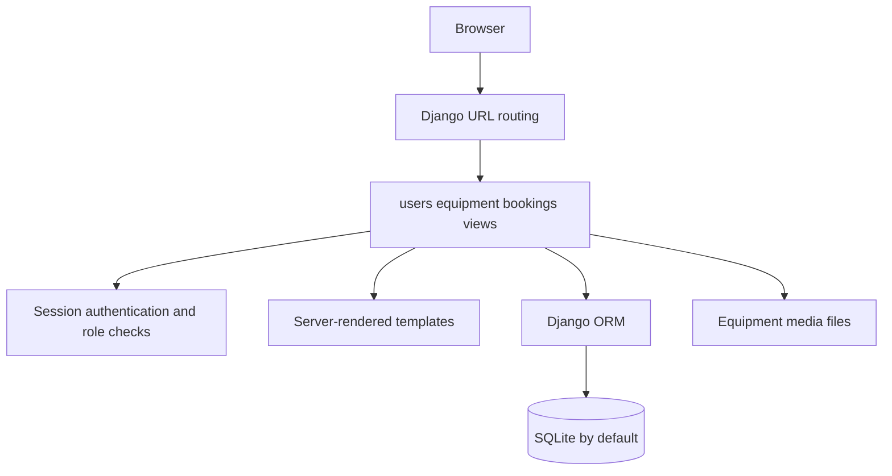
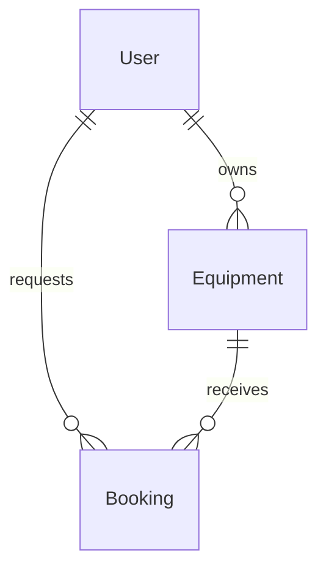

<a id="top"></a>

<div align="center">

# 🚜 GreenGear

**A Django equipment rental platform connecting farmers and machinery owners.**


[Repository](https://github.com/ashishgiije/GreenGear) · [Overview](#overview) · [Architecture](#architecture) · [Setup](#setup) · [Validation](#testing-and-validation) · [Audit](AUDIT_REPORT.md)

</div>

## Overview

GreenGear models agricultural equipment listings and rental requests. Farmers browse and book machinery; owners manage equipment and respond to bookings; administrative screens manage users. This repository demonstrates Django’s model–template–view architecture and session-based access control.

## Visual preview

**Screenshot placeholder:** No verified application screenshot is supplied here. Capture the equipment listing, farmer booking, and owner dashboard using disposable accounts. No image is fabricated.

## Key features

- Separate farmer and owner registration and dashboards.
- Equipment listings with categories, rates, locations, images, and availability.
- Booking requests with hourly/daily pricing and status changes.
- Farmer booking history and owner request lists.
- Profile, password, and administrative user workflows.

## Technology stack

| Technology | Role in this checkout |
|---|---|
| Python + Django 5.2 | Server-rendered application, authentication, ORM |
| SQLite / DATABASE_URL | Default local database and configurable database URL |
| HTML + CSS + JavaScript | Template-driven interface |
| Pillow | Equipment image handling |

## Architecture



## Application workflow

Owner registers and lists equipment → farmer registers and browses listings → farmer requests a booking → owner approves or rejects → completion is recorded. Payment messaging describes cash on delivery; no payment gateway is implemented.

## Setup

```bash
git clone https://github.com/ashishgiije/GreenGear.git
cd GreenGear
```

Use Python 3.12 and a virtual environment. The pinned requirements include PostgreSQL adapters that may need system compiler/libpq headers even when using SQLite.

```bash
python3 -m venv .venv
. .venv/bin/activate
pip install -r requirements.txt
# Use a disposable database, avoiding the committed example database
export DATABASE_URL="sqlite:////tmp/greengear-dev.sqlite3"
python manage.py migrate
python manage.py createsuperuser
python manage.py runserver 127.0.0.1:8000
```

Open `http://127.0.0.1:8000`. `DATABASE_URL` is supported by `dj_database_url`; SQLite is the default. The current `SECRET_KEY` and `DEBUG` are hardcoded, so adding similarly named environment variables does not override them. Production configuration needs a separate reviewed fix. `python manage.py collectstatic` prepares static assets; production hosting still requires secure settings and media storage.

**SQLite workaround for the current settings defect:** before the migrate/runserver commands, create a settings module outside the checkout and select it. This removes an invalid SQLite option; it does not disable TLS for network databases.

```bash
mkdir -p /tmp/greengear-settings
cat > /tmp/greengear-settings/greengear_local_settings.py <<'EOF'
from greengear_project.settings import *
DATABASES["default"].get("OPTIONS", {}).pop("sslmode", None)
EOF
export PYTHONPATH="/tmp/greengear-settings:$PWD"
export DJANGO_SETTINGS_MODULE=greengear_local_settings
```

Keep DATABASE_URL pointed at disposable local SQLite when using this workaround.

## Project structure

```text
greengear_project/ # Settings, root routes, WSGI/ASGI
users/             # Custom user, roles, account views
equipment/         # Equipment model and listing views
bookings/          # Booking model, pricing, status flows
templates/         # Server-rendered pages
static/            # Styles and browser scripts
media/             # Equipment uploads
```

## Data relationships



Django’s custom `users.User` extends `AbstractUser`. Bookings belong to a farmer and an equipment listing; equipment belongs to its owner. Sessions and CSRF middleware protect ordinary form workflows, but the status route needs a method restriction (see the audit).

## Routes

This is a server-rendered web application rather than a documented JSON API. Route definitions are in `users/urls.py`, `equipment/urls.py`, and `bookings/urls.py`; they are mounted by `greengear_project/urls.py`. Use the UI’s generated form actions for login, listing, booking, and status changes.

## Testing and validation

Current source review and checks (4 November 2026):

Django system check passed; default SQLite migrations failed because ssl_require=True injects unsupported sslmode. With an external settings module removing SQLite sslmode, migrations and an HTTP 200 homepage/content check passed. The test runner found zero tests.

Use `python manage.py check`, `python manage.py migrate`, and `python manage.py test` in the configured environment. A zero-test run is not application coverage.

## Limitations and roadmap

- Bookings use availability checks and active-booking checks rather than a complete time-interval reservation engine.
- Payment is cash on delivery; online payment and settlement are not implemented.
- Several administrative equipment views reference missing templates.
- Suggested roadmap: secure production settings, POST-only state changes, transaction-safe reservations, and meaningful Django tests.

<details>
<summary>Troubleshooting and contributions</summary>

Check the runtime versions and working directory first. For dependency installation failures, preserve TLS and checksum verification and inspect the first error. For external services, verify your local configuration and account permissions without sharing secret values.

Before contributing, read [the audit](AUDIT_REPORT.md), reproduce the affected behavior, and keep documentation changes separate from application fixes. Add tests for changed behavior and describe remaining limitations accurately.

</details>

## Author

**Ashish Gije** · [GitHub](https://github.com/ashishgiije)

[Back to top](#top)
